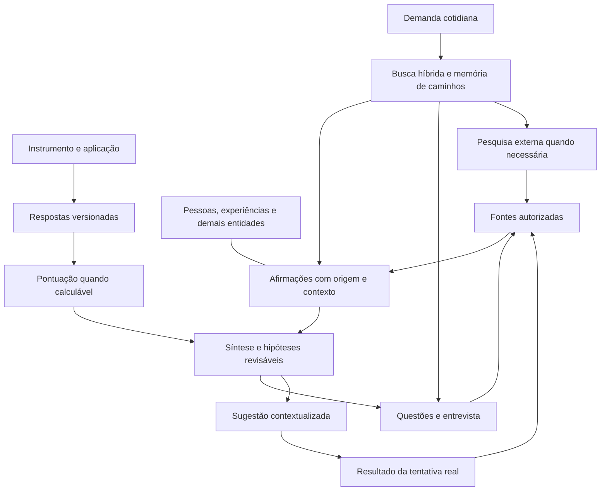

> Complemento 07 — atribuição e continuações: consulte [17 — Atribuição e continuações](manual-cerebro-17-atribuicao-e-continuacoes.md).

# Manual do cérebro pessoal — índice da versão inicial

> Recuperação de tarefas e supervisão: consulte [16 — Retomada e supervisão](manual-cerebro-16-retomada-e-supervisao.md). Este complemento acrescenta mecanismos à execução 0.5 descrita abaixo.

> Estado vigente de execução — versão 0.5. Consulte [15 — Garantias de execução](manual-cerebro-15-garantias-de-execucao.md). As atualizações anteriores abaixo preservam o histórico da construção. O capítulo 14 descreve a base da execução e o capítulo 15 descreve a integração vigente.

Especificação da arquitetura, dos contratos e do modelo declarativo de dados. Para testar com isolamento, utilize um cofre temporário/fictício em `testes_temporarios/` antes de operar no seu cofre principal. Este índice localiza os capítulos completos; não os substitui por uma leitura resumida.

As indicações de “não implementado” nos capítulos originais descrevem o estado da especificação à época da redação; o status vigente dos módulos e das suítes automatizadas consta no README do repositório.

## Manual completo

| Capítulo | Conteúdo |
|---|---|
| [01 — Fundamentos](manual-cerebro-01-fundamentos.md) | Responsabilidades, evidência, tempo, identidade, limites e princípios. |
| [02 — Processos e contratos](manual-cerebro-02-processos-e-contratos.md) | Os catorze processos e seus caminhos completos. |
| [03 — Estados e execução](manual-cerebro-03-estados-e-execucao.md) | Espera, cancelamento, confirmação, falhas e retomada. |
| [04 — Interações e políticas](manual-cerebro-04-interacoes-e-politicas.md) | Entregas, suficiência, perguntas, autoridade, limites e critérios de aceitação. |
| [05 — Memória de buscas](manual-cerebro-05-memoria-de-busca.md) | Histórico, resultado reutilizável, receitas, novidades e economia. |
| [06 — Modelo inicial e avaliação](manual-cerebro-06-modelo-de-registros.md) | Famílias de registros, aplicação, respostas, pontuação e interpretação. |
| [07 — Experiências e entrevista](manual-cerebro-07-experiencias-e-entrevista.md) | Fonte conversacional, decisão, ação, resultado e perguntas contextualizadas. |
| [08 — Catálogo de dados](manual-cerebro-08-catalogo-de-dados.md) | Campos comuns, tipos de domínio, fontes, afirmações, sínteses, questões e instrumentos. |
| [09 — Registros operacionais](manual-cerebro-09-registros-operacionais.md) | Execuções, alterações, confirmação, cobertura de índices, busca, fila e avaliação de melhorias. |
| [10 — Relações e validação](manual-cerebro-10-relacoes-e-validacao.md) | Predicados, origens/destinos, cardinalidades e 22 regras de validação. |
| [11 — Representação e acesso](manual-cerebro-11-representacao-e-acesso.md) | Organização proposta, campos canônicos, templates e papéis de acesso. |

## Como os registros se conectam

O diagrama mostra o encadeamento de informação, não neurônios biológicos ou concessões automáticas de autoridade.

## Decisões já estabelecidas que não precisam ser reabertas

- Informação pessoal essencial ausente: procurar no escopo disponível; quando depender do usuário, perguntar, registrar pendência e aguardar. A resposta alimenta a retomada, sem garantir resolução automática.
- Uma busca sem resultado é registrada no alcance operacional e de retenção pertinente; não é prova de inexistência nem experiência pessoal nova.
- Uma receita de busca orienta investigação. Sua existência, repetição ou popularidade não é evidência biográfica independente.
- Leitura, escrita e acesso seguem políticas e contratos validados pelo serviço. Metadado numa nota e filtro de descoberta não concedem autoridade efetiva.
- Conhecimento, conclusões e sistema podem evoluir, com fontes, versões, critérios, avaliação e recuperação. Uma mudança em texto não instala uma ferramenta.
- Rastreamento, hipótese, relato de diagnóstico e documento profissional são distintos. Nenhum deles foi preenchido com dados inventados.

## Revisões e pesquisa

- [Revisão dos processos](revisao-logica-processos.md).
- [Revisão da modelagem e alcance da conferência](revisao-modelagem-inicial.md).
- [Proposta técnica de busca híbrida](proposta-busca-hibrida.md).
- [Artigos e relatos sobre busca/comunicação](pesquisa-busca-e-comunicacao.md).
- [Confiabilidade das integrações por contrato](avaliacao-integracoes-por-contrato.md).
- [Lista de integrações pesquisadas](pesquisa-integracoes-codex-obsidian.md).

## Próxima passagem para execução

Este conjunto permite preparar a estrutura e a implementação sem inventar biografia. Antes de uso pessoal automático, transformar contratos em ferramentas/validadores reais e testar leitura, acesso, escrita concorrente, repetição, falha parcial, descoberta de novidades e invalidação. Valores operacionais e identidades/políticas efetivas dependem da implantação; seleção de instrumentos depende das verificações documentadas.

A etapa de laboratório verificou parte desses mecanismos; permanecem limites materiais em acesso direto, edição externa concorrente, exclusão/restauração completa, busca vetorial e validação de todos os contratos. A ponte registrada ainda precisa ser descoberta pela sessão do usuário. Depois da voz, recarregar o cliente e conferir o catálogo é o passo remanescente indicado pelo diagnóstico; não afirmar conexão ativa só pela existência do arquivo de configuração.

O cofre de uso do usuário será novo. Testes usam uma base separada com exemplos fictícios/autorizados. A avaliação inicial vem antes da entrevista ampla, com registros preparados e localização de armazenamento explícita.

## Atualização de implantação — 29 de outubro de 2026

O cofre do usuário (`EMC_VAULT`, padrão `./meu-cofre`) permanece separado de qualquer fixture fictícia de teste. O acesso a conteúdo pessoal está bloqueado por padrão (`CEREBRO_PESSOAL_ACESSO` precisa ser explicitamente habilitado); a descoberta da ponte não significa prontidão para registrar informação sensível. Permanecem requisitos de autorização por consumidor, retenção, exclusão/restauração completa e recuperação. As afirmações anteriores sobre não haver cofre ou descoberta descrevem a situação histórica da redação.

A organização visual deve permitir grupos por cores e filtros de tipos ou tags consistentes, preservando todas as notas e relações. Posição automática, critérios concretos e configuração exigem implementação e validação separadas em dados fictícios; a existência de grupos no Obsidian não prova layout inteligente ou agrupamento semântico.

### Grafo: configuração inicial verificada

Em fixture fictícia, o grupo do Obsidian por caminho coloriu uma entidade sem remover as três notas ou suas ligações. Depois foram configurados dez grupos por pasta no cofre pessoal, com filtro geral vazio e notas órfãs visíveis; o grafo reaberto mostrou cores nos manuais e nas orientações. A cor reflete organização por pasta, não significado, diagnóstico ou personalidade. A posição continua no layout padrão; posicionamento semântico automático é uma candidata não implementada.

## Atualização de acesso por projeto — 29 de outubro de 2026

O usuário autorizou a gravação para a futura entrevista. A configuração efetiva do projeto da conversa foi testada com acesso permitido à ponte pessoal; fora desse projeto, a configuração global permanece bloqueada. Esse é um limite de projeto, não autenticação por conversa ou por IA: outras sessões no mesmo diretório compartilham o acesso, e processos da mesma conta podem acessar arquivos diretamente. A ferramenta de exclusão está desabilitada na configuração do projeto de entrevista. A sessão ativa precisa confirmar por `estado` que carregou a nova configuração antes de registrar qualquer fonte. Não se pode inferir um perfil nem aplicar instrumentos clínicos a partir da configuração.

Foram testados, em cofre fictício descartável, criação, leitura, retificação, repetição após reinício e exclusão controlada. No cofre pessoal, o teste da configuração fez apenas leitura de estado e contagem de fontes; nenhum dado fictício pessoal foi gravado. Histórico, cópias externas, backups e ausência de criptografia conservam os limites explicados em [[Limites atuais]].

## Extensão de execução 0.2 — implantação verificada

As funções novas e os limites reais estão em [12 — Execução verificada](manual-cerebro-12-execucao-verificada.md). Os capítulos anteriores continuam sendo a referência dos contratos; suas declarações históricas de implementação não substituem este estado de implantação. A extensão suporta fontes e extrações explícitas, busca lexical/grafo limitada e checagem de referências; não representa o cumprimento integral do roadmap.

## Autonomia local 0.3 — manutenção e apoio a decisões

O capítulo [13 — Autonomia local](manual-cerebro-13-autonomia-local.md) descreve o trabalhador limitado, sua fila, estados, limites e parada. Ele preserva os contratos anteriores e documenta o subconjunto executado. Não representa interpretação autônoma de toda a entrevista nem adoção automática de código. O relatório de implantação distingue os testes da ativação real.

## Execução integrada 0.4 — estado vigente

Consulte [14 — Execução integrada](manual-cerebro-14-execucao-integrada.md) para coordenador, busca híbrida, cache, revisão semântica, pesquisa, avaliações estruturadas e laboratório acionado por eventos. As descrições de ausência nos capítulos 12 e 13 retratam as versões anteriores. O relatório da implantação registra quais cenários passaram e os limites que continuam abertos. Relatos antigos e pontuações pendentes não se tornam automaticamente verificados. Não criar outro cofre antes da validação do primeiro.

A instalação 0.4 e sua sucessora 0.5–0.7 estão descritas nos capítulos 14 a 17. Consultar o estado corrente do trabalhador e as suítes de autoteste pelo serviço.

