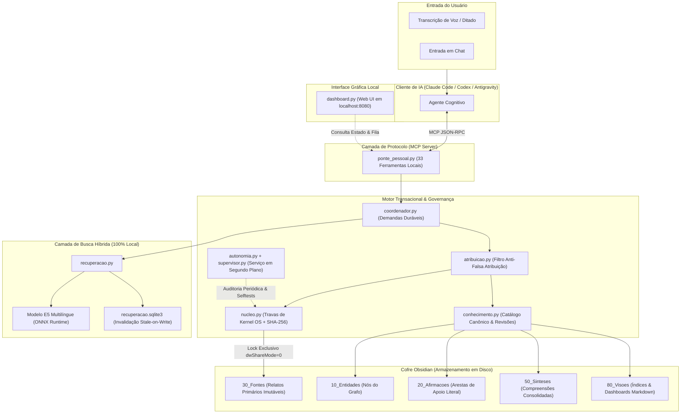
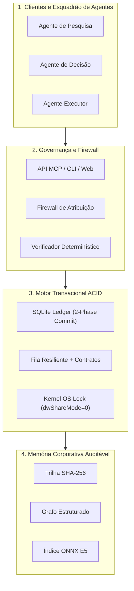
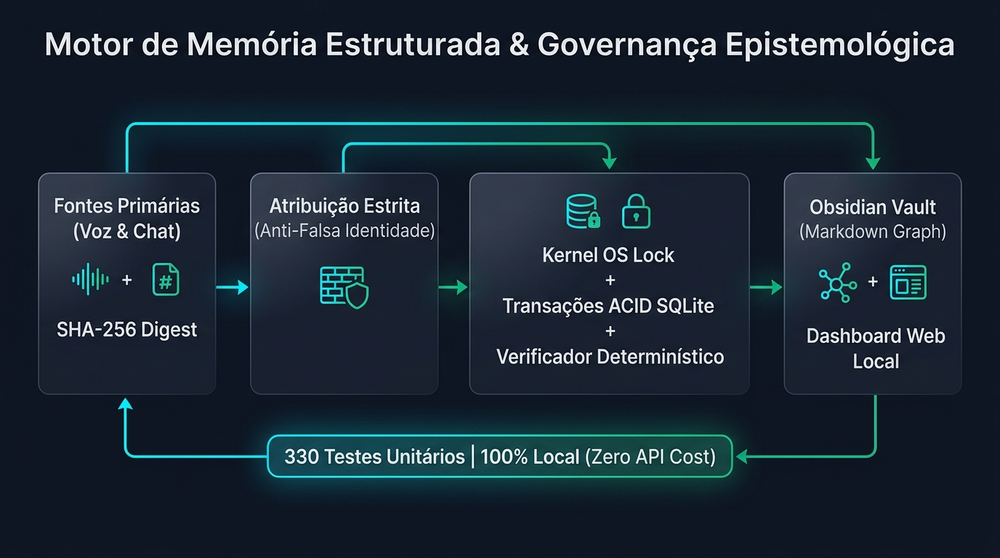
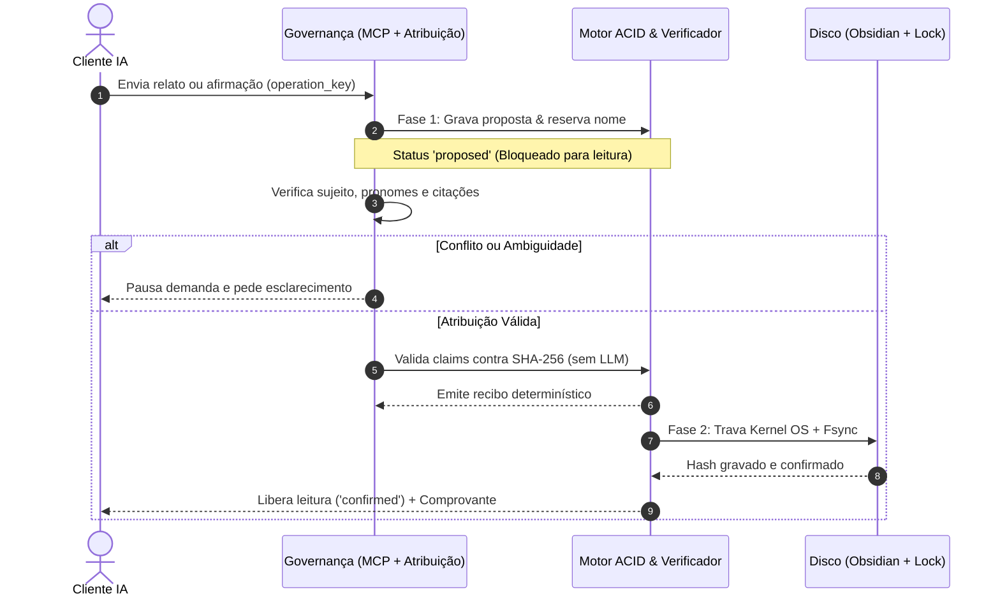

# Epistemic Memory Core — Protocolo Universal de Memória Estruturada para IA

> **Motor de memória auditável, governança epistemológica e busca híbrida local para assistentes de IA, integrado ao Obsidian via Model Context Protocol (MCP) e expansível para arquiteturas multi-agente.**

[](https://www.python.org/)
[](https://modelcontextprotocol.io/)
[-green.svg)](https://github.com/microsoft/onnxruntime)
[](https://obsidian.md/)
[](#-suíte-de-testes-automatizados)
[]()

---

## 💡 O que é o projeto?

O **Cérebro Pessoal Engine** é uma infraestrutura de software projetada para resolver os maiores gargalos de confiabilidade em sistemas de memória para Inteligência Artificial:

1. **Amnésia e Alucinação Cumulativa:** Assistentes tradicionais misturam fatos observados com inferências sintéticas e perdem a linhagem das premissas.
2. **Corrupção de Estado e Condições de Corrida (*Race Conditions*):** Múltiplos processos ou agentes escrevendo sem travas de nível de sistema operacional e sem reserva atômica de nomes.
3. **Leituras Sujas (*Dirty Reads*):** Modelos consumindo rascunhos ou propostas não confirmadas como se fossem dados canônicos consolidados.
4. **Falsa Atribuição de Autoria:** Confusão semântica ao atribuir falas de terceiros ou citações ao sujeito principal.

O sistema implementa um **protocolo rigoroso de memória governada**: identificadores únicos imutáveis (UUIDv4), histórico de revisões em cadeia de custódia, digest SHA-256 em cada arquivo, verificação formal de alegações sem chamadas pagas a modelos, e separação epistemológica entre **fontes primárias** e **conhecimento derivado**.

---

## 🏛️ Diagramas Arquiteturais de Funcionamento

### Cenário 1: Gestão Pessoal de Conhecimento (Second Brain com Obsidian)

Neste modo, o motor atua como a infraestrutura de apoio cognitivo pessoal, alimentando um cofre do Obsidian com dados auditáveis e navegação em grafo.



---

### Cenário 2: Aplicação Universal para Software & Agentes Autônomos (Enterprise Memory)

O mesmo motor pode ser desacoplado do uso pessoal e servir como **camada de memória auditável** para outros sistemas de software e fluxos com múltiplos agentes:



#### Aplicações Industriais & de Software:
- **Área Jurídica & Compliance:** Auditoria de alegações processuais onde nenhuma inferência de IA pode ser citada sem apoio literal em documento primário com hash comprovado.
- **Área Médica & Prontuários:** Separação rígida entre sintomas relatados pelo paciente (Fontes) e hipóteses diagnósticas (Entidades/Afirmações), com bloqueio de falsa atribuição de familiares.
- **Fintech & Operações Críticas:** Registro de decisões de agentes financeiros com comprovantes determinísticos imutáveis (`avaliar_resposta` e `consultar_comprovante`).

---

### Cenário 3: Fluxo Completo de Ponta a Ponta (*End-to-End Lifecycle*)

Abaixo está o ciclo de vida completo de uma contribuição, mostrando desde a entrada do usuário até a gravação segura no disco com proteção contra falhas e prevenção de *dirty reads*:





---

## 🖥️ Interface Web Local (`dashboard.py`)

O repositório inclui uma interface gráfica moderna, responsiva e em modo escuro, construída **exclusivamente com a biblioteca padrão do Python** (sem necessidade de instalar React, Node.js ou frameworks pesados).

### Funcionalidades do Dashboard:
- **Monitor de Saúde em Tempo Real:** Status de atividade do worker, PID vivo, tempo de heartbeat e volume de tarefas completadas.
- **Explorador da Busca Híbrida:** Teste visual de consultas com pontuação RRF, combinando vetores semânticos locais (E5) com busca léxica e relações do grafo.
- **Painel de Demandas e Pendências:** Visualização clara das dúvidas de atribuição e perguntas abertas do sistema.
- **Ações Rápidas de Manutenção com 1 Clique:** Disparo de auditorias de integridade do cofre, reconstrução de visões e execução dos autotestes.

Para iniciar o dashboard:
```bash
python src/dashboard.py
# Acessível instantaneamente no navegador: http://127.0.0.1:8080
```

---

## 📂 Estrutura do Repositório

```text
├── 00_Manual/                   # Especificação formal completa (17 capítulos normativos)
├── config/                      # Configurações e manifestos (autonomia.json, execucao.json, manual_manifest.json)
├── docs/                        # Diagramas de arquitetura e guias operacionais
│   ├── arquitetura.jpg
│   └── guias/
├── scripts/                     # Utilitários de inicialização e execução em segundo plano
│   ├── iniciar-template.py      # Assistente de inicialização de cofre limpo para novos usuários
│   └── iniciar-trabalhador.ps1  # Inicializador do worker em segundo plano (Windows)
├── src/                         # Código-fonte do motor epistêmico (24 módulos Python)
│   ├── nucleo.py                # Motor de baixo nível: exclusão de compartilhamento, SHA-256 e SQLite
│   ├── conhecimento.py          # Catálogo canônico, validação de esquemas e relações em grafo
│   ├── evidencias.py            # Adaptador de evidências estruturadas e verificação de alegações
│   ├── verificador_evidencias.py # Verificador determinístico de claims (campos, somas, cadeias transitivas)
│   ├── atribuicao.py            # Firewall de atribuição: isolamento estrito de sujeito e citações
│   ├── recuperacao_fila.py      # Recuperação resiliente da fila SQLite e contratos congelados
│   ├── supervisor.py            # Supervisor de monitoramento contínuo do processo trabalhador
│   ├── coordenador.py           # Gerenciador durável de demandas, etapas e dependências
│   ├── recuperacao.py           # Busca híbrida (E5 ONNX local + léxica + referências com RRF)
│   ├── autonomia.py             # Fila durável de tarefas e trabalhador (worker) em segundo plano
│   ├── autoteste.py             # Suíte de autotestes disparada por alteração de hash de código
│   ├── ponte_pessoal.py         # Servidor Model Context Protocol (MCP) com 33 ferramentas
│   ├── dashboard.py             # Interface web gráfica local (zero dependências externas)
│   ├── cli.py                   # Interface de linha de comando para operação local
│   ├── esquemas.py              # Contratos e validadores tipados dos registros (brain-json)
│   ├── avaliacoes.py            # Contratos para instrumentos e cálculo determinístico de escores
│   ├── documentos.py            # Registro e validação de documentos estruturados
│   ├── execucao.py              # Orquestração da fila integrada e ciclo de leitura/extração
│   ├── revalidacao.py           # Gatilhos e controle de revalidação pós-retificação
│   ├── pesquisa.py              # Integração controlada com Crossref (apenas temas autorizados)
│   ├── provedores.py            # Chamada segura a modelos textuais com subprocesso isolado
│   ├── melhorias.py             # Módulo de avaliação e adoção atômica de melhorias de código
│   └── revisoes.py              # Controle de revisões e histórico de auditoria
├── tests/                       # 19 suítes ativas (autoteste) + 2 scripts MCP históricos + apoio_testes04.py
├── LICENSE                      # Licença personalizada: Uso Pessoal / Não Comercial Exclusiva do Autor
├── pyproject.toml               # Metadados do pacote e configuração de testes
└── requirements-execucao04.txt  # Dependências Python
```

---

## 📖 O Manual de Arquitetura (17 Capítulos)

O diretório [`00_Manual/`](00_Manual/) contém a especificação formal que rege o comportamento de qualquer IA que opere sobre o cofre:

| Capítulo | Nome | Finalidade |
| :--- | :--- | :--- |
| **01** | Fundamentos | Princípios epistemológicos, não-alucinação e primazia da evidência. |
| **02** | Processos e Contratos | Fluxo dos 14 processos formais (P01 a P14). |
| **03** | Estados e Execução | Máquinas de estados para fontes, entidades, afirmações e demandas. |
| **04** | Interações e Políticas | Políticas de acesso, retenção, consentimento e segurança. |
| **05** | Memória de Busca | Diretrizes para indexação, busca híbrida e expiração de cache. |
| **06** | Modelo de Registros | Especificação do cabeçalho YAML e payload tipado `brain-json`. |
| **07** | Experiências e Entrevista | Condução da entrevista ampla e coleta contextual. |
| **08** | Catálogo de Dados | Tipos de entidades (`person`, `project`, `habit`, etc.) e predicados. |
| **09** | Registros Operacionais | Logs, histórico de consultas e auditoria técnica. |
| **10** | Relações e Validação | Regras de validação de arestas e restrição contra diagnóstico implícito. |
| **11** | Representação e Acesso | Visualização em grafo (cores por pasta) e interfaces. |
| **12** | Execução Verificada | Especificação da Extensão 0.2 (MCP de conhecimento e autotestes). |
| **13** | Autonomia Local | Especificação da Entrega 0.3 (Worker local e fila persistente). |
| **14** | Execução Integrada | Busca E5 local ONNX, coordenador durável e laboratório de autoevolução. |
| **15** | Garantias de Execução | Reserva atômica de nomes, bloqueio de dirty reads e recibos de evidência. |
| **16** | Retomada e Supervisão | Recuperação controlada de tarefas expiradas e supervisor do worker. |
| **17** | Atribuição e Continuações | Isolamento estrito de sujeito/citações e contratos de fila congelados. |

---

## 🚀 Como Começar do Zero (Template Limpo)

O guia usa **Windows com PowerShell** ou **Linux com Bash**. O macOS usa a mesma implementação POSIX, com validação nessa plataforma ainda pendente. O supervisor de reinício por PowerShell é específico do Windows. No Linux, o trabalhador pode ser iniciado com `./.venv/bin/python src/autonomia.py serve` quando habilitado na configuração.

### 1. Clonar e Instalar Dependências
```powershell
git clone https://github.com/leoguimaraes49/epistemic-memory-core.git
cd epistemic-memory-core

python -m venv .venv
.\.venv\Scripts\python.exe -m pip install -r requirements-execucao04.txt
```

No Linux, após clonar e entrar no diretório do repositório, crie o ambiente e instale as dependências.

```bash
python3 -m venv .venv
./.venv/bin/python -m pip install -r requirements-execucao04.txt
```

Nos comandos de inicialização do cofre e do painel, use `./.venv/bin/python` no Linux.

### 2. Inicializar um Novo Cofre Vazio
Execute o script utilitário para criar as pastas e tabelas relacionais do seu novo cofre:
```powershell
.\.venv\Scripts\python.exe scripts/iniciar-template.py --destino ./meu-cofre --nome "Meu Cérebro"
```

### 3. Iniciar o Dashboard Gráfico
```powershell
.\.venv\Scripts\python.exe src/dashboard.py
```
Abra seu navegador em `http://127.0.0.1:8080` para acompanhar o estado do sistema.

### 4. Conectar seu Assistente de IA via MCP
Use o Python do ambiente virtual e o caminho absoluto do servidor. Para permitir que esse cliente acesse o cofre, defina `CEREBRO_PESSOAL_ACESSO=permitido` no ambiente do servidor. O exemplo usa o formato JSON de clientes com `mcpServers`.

```json
{
  "mcpServers": {
    "cerebro_pessoal": {
      "command": "C:/caminho/epistemic-memory-core/.venv/Scripts/python.exe",
      "args": ["C:/caminho/epistemic-memory-core/src/ponte_pessoal.py"],
      "env": { "CEREBRO_PESSOAL_ACESSO": "permitido" }
    }
  }
}
```

No Linux, use caminhos absolutos para `.venv/bin/python` e `src/ponte_pessoal.py`.

---

## Busca vetorial local

A configuração inicial usa busca por texto e pelas ligações do grafo. A etapa vetorial usa o modelo multilíngue E5 em CPU. Os dois arquivos também são necessários para aprovar a bateria completa exigida pela ponte antes de processar contribuições e buscar contexto. Baixe-os da revisão indicada e salve-os em `modelos/e5-multilingual-small/`.

- [model.onnx](https://huggingface.co/intfloat/multilingual-e5-small/blob/614241f622f53c4eeff9890bdc4f31cfecc418b3/onnx/model.onnx) (470 MB).
- [tokenizer.json](https://huggingface.co/intfloat/multilingual-e5-small/blob/614241f622f53c4eeff9890bdc4f31cfecc418b3/tokenizer.json) (17 MB).

O motor confere os SHA-256 dos dois arquivos antes de carregá-los. Para habilitar a busca vetorial no uso normal, defina `embeddings.enabled` como `true` em `config/execucao.json` e coloque o caminho absoluto da pasta em `embeddings.folder`. Se os arquivos estiverem fora da pasta padrão, defina também `EMC_EMBEDDINGS_DIR` para a suíte.

## 🧪 Suíte de Testes Automatizados

O repositório contém **19 suítes automatizadas** em [`tests/`](tests/), com casos unitários e verificações MCP de ponta a ponta usando dados fictícios em diretórios temporários. Para rodar a bateria completa, instale primeiro os dois arquivos da busca vetorial.

```powershell
# Executar a bateria completa das 19 suítes com validação criptográfica por hash de código
$env:CEREBRO_PESSOAL_ACESSO = "permitido"
.\.venv\Scripts\python.exe src/cli.py autotestes
```

No Linux, execute `CEREBRO_PESSOAL_ACESSO=permitido ./.venv/bin/python src/cli.py autotestes`.

Sem os recursos vetoriais e sem um caminho alternativo configurado, a suíte vetorial fica como `skipped` e o resultado geral fica `incomplete` se as demais passarem. Um caminho explícito inválido ou uma instalação parcial gera falha. As operações que exigem a bateria completa continuam condicionadas a um relatório `passed`.

### Principais Suítes Cobertas:
- **`tests/testes.py`**: Integridade atômica, exclusão de arquivo pelo SO e digest SHA-256.
- **`tests/testes_persistencia05.py`**: Concorrência de múltiplos processos e prevenção de dirty reads.
- **`tests/testes_evidencias.py`**: Verificador determinístico de claims sem chamada a modelo.
- **`tests/testes_atribuicao.py`**: Controle estrito contra mistura de falas e citações.
- **`tests/testes_recuperacao_fila.py`**: Tolerância a falhas e contratos de continuidade congelados.
- **`tests/testes_melhorias_seguranca.py`**: Laboratório de autoevolução e proteção contra symlinks maliciosos.
- **`tests/testes_coordenador.py`**: Orquestração de demandas duráveis e grafos de dependência.
- **`tests/testes_conhecimento.py`**: Validação de entidades, afirmações e restrições de esquemas.
- **`tests/testes_esquemas.py`**: Contratos tipados e cálculos de escores reproduzíveis.

---

## 🛡️ Garantias e Limites Conscientes

- **Controles implementados.** Conferência local por SHA-256, histórico de revisões auditável, controle de concorrência, transações SQLite e busca híbrida quando os recursos vetoriais estão instalados.
- **Travas por plataforma.** O Windows bloqueia operações incompatíveis de outros programas enquanto o arquivo está aberto com exclusividade. A trava POSIX coordena os processos que a respeitam. O motor detecta divergências observáveis de conteúdo e identidade. Em POSIX, faça alterações nas notas gerenciadas pela ponte e use o Obsidian para consultá-las. [Garantias e limites da execução](00_Manual/manual-cerebro-15-garantias-de-execucao.md#arquivos-controlados-por-plataforma)
- **O que este sistema NÃO faz:** Não inventa diagnósticos clínicos, não emite probabilidades sem suporte empírico, não envia dados privados para serviços externos não autorizados e não executa código arbitrário sem isolamento em fixture.

---

## 📄 Licença

Disponibilizado sob licença personalizada **Non-Commercial Source-Available** ([`LICENSE`](LICENSE)) de autoria exclusiva de **Leonardo Guimarães (`@leoguimaraes49`)**:
- ✅ **Permitido:** Estudo, auditoria de código, pesquisa acadêmica e uso estritamente pessoal sem fins lucrativos.
- ❌ **Proibido a terceiros:** Uso comercial, revenda, exploração como SaaS/serviço hospedado ou integração em produtos comerciais. Todos os direitos de exploração comercial pertencem exclusivamente ao autor.
